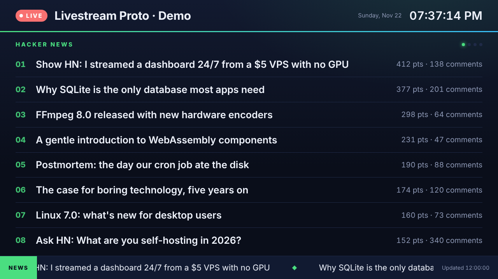

# livestream-proto

[](https://github.com/NotNahid/livestream/actions/workflows/ci.yml)
[](https://NotNahid.github.io/livestream/)
[](LICENSE)

**Go live from any Linux server. No OBS, no monitor, no GPU.**
A virtual screen (Xvfb) shows a web page in Chromium and FFmpeg pushes it to Twitch, YouTube, Kick, Facebook or any RTMP server.

> Replace `NotNahid` in this file and in `docs/index.html` with your GitHub username after you push.



## Features

- **Pluggable data sources**: Hacker News, RSS/Atom, Reddit, GitHub, crypto prices, weather, static text, or any text file another program writes.
- **Scene rotation, scrolling ticker, 4 themes** (midnight, daylight, neon, terminal). Scales cleanly to 720p / 1080p.
- **Live control panel** (`/control.html`): show a banner, pin a scene, pause rotation or switch theme with no restart. Works from your phone.
- **Self-healing**: auto-reconnect with back-off, crashed browser restarts, last good data is kept when a feed fails.
- **`./doctor.sh`** preflight check and **`./run.sh --dry-run`** to test without a stream key.
- **Safe defaults**: stream key masked in logs, `.env` git-ignored and `chmod 600`, control API on localhost and token-protected.
- **VTuber mode**: a character drawn by Python, a babble voice made from letters, sound effects and karaoke subtitles (see below).
- **Docker image**, GitHub Actions CI, GitHub Pages site with a config builder.

## Quick start

```bash
git clone https://github.com/NotNahid/livestream && cd livestream
./start.sh            # installs everything, asks a few questions, goes live
```

Or step by step:

```bash
./setup.sh                    # apt packages, Python venv, Chromium
cp .env.example .env          # then put your stream key in it
cp config.example.json config.json   # optional: choose data sources and theme
./doctor.sh                   # checks everything
./run.sh --dry-run            # no key needed: records logs/dry-run.mkv
./run.sh                      # go live
./stop.sh                     # stop (also if the terminal froze)
```

Open `http://127.0.0.1:8080/control.html` while running to steer the stream. On a remote machine use an SSH tunnel: `ssh -L 8080:127.0.0.1:8080 you@server`.

## How it works

```
vtuber/     -> optional VTuber: face.py (SVG), voice.py (babble audio), __main__.py (director)
agent.py    -> fetches data from your sources, writes web/data.json
server.py   -> serves web/ and the control API (/api/state, /api/status)
web/        -> index.html (the streamed overlay), control.html, player.html
browser.py  -> opens the overlay in kiosk Chromium on the virtual screen
run.sh      -> starts everything, runs FFmpeg to the RTMP server, reconnects on failure
```

## Configuration

### `.env` (stream settings, secrets)

| Variable | Default | Meaning |
|---|---|---|
| `STREAM_KEY` | n/a | Your platform's stream key. **Never commit it.** |
| `PLATFORM` | `twitch` | `twitch`, `youtube`, `facebook`, `kick`, `custom` |
| `RTMP_URL` | per platform | Required for `kick` / `custom`; overrides the preset |
| `MINUTES` | `10` | Run length. `0` = until stopped |
| `AUTO_RESTART` | `1` | Reconnect when the connection drops |
| `RESOLUTION` | `1280x720` | e.g. `1920x1080` |
| `FPS` / `VIDEO_BITRATE` / `AUDIO_BITRATE` | `30` / `2500k` / `128k` | Twitch allows up to ~6000k |
| `X264_PRESET` | `veryfast` | Slower = better quality, more CPU |
| `SILENT_AUDIO` | `0` | `1` = never use PulseAudio |
| `PORT` / `BIND` / `ADMIN_TOKEN` | `8080` / `127.0.0.1` / unset | Control panel. `BIND=0.0.0.0` **requires** `ADMIN_TOKEN` |
| `PAGE_URL` | built-in overlay | Stream any page or YouTube video you own |
| `GITHUB_TOKEN` | unset | Optional, raises GitHub API limits |

### `config.json` (what is shown)

```json
{
  "title": "Live Dashboard",
  "theme": "midnight",
  "rotate_seconds": 15,
  "refresh_seconds": 60,
  "ticker": true,
  "sources": [
    { "type": "hackernews", "limit": 8 },
    { "type": "rss", "url": "https://feeds.bbci.co.uk/news/world/rss.xml" },
    { "type": "crypto", "coins": ["bitcoin", "ethereum"], "currency": "usd" },
    { "type": "weather", "places": [{ "name": "Dhaka", "lat": 23.81, "lon": 90.41 }] },
    { "type": "file", "path": "feed.txt", "title": "From my script" }
  ]
}
```

| `type` | Options |
|---|---|
| `hackernews` | `limit` |
| `rss` | `url` (RSS 2.0 or Atom), `limit`, `title` |
| `reddit` | `subreddit`, `period` (`day`, `week`...), `limit` |
| `github` | `days`, `language`, `limit` (fastest-growing new repos) |
| `crypto` | `coins` (CoinGecko ids), `currency` |
| `weather` | `places: [{name, lat, lon}]` (Open-Meteo, no key) |
| `text` | `title`, `lines` |
| `file` | `path` (inside the project), `title`, `limit`, `kind`. One line each: `title` or `title \| meta` |

**Add your own source** (an LLM, a database, a scraper): write a function in `agent.py` decorated with `@source("mine")` that returns `{"kind": "list", "title": "...", "items": [{"title": "...", "meta": "..."}]}`, then use `{"type": "mine"}` in `config.json`. Or just have any program write lines to a file and use the `file` source.

Overlay URL options: `?theme=neon`, `?scene=p1`, `?rotate=10`, `?demo=1`.

### Control API

```bash
curl -X POST http://127.0.0.1:8080/api/state -H 'Content-Type: application/json' \
     -H "X-Admin-Token: $ADMIN_TOKEN" -d '{"message":"Giveaway in 5 minutes!","message_seconds":60}'
```

Fields: `message`, `message_seconds`, `scene` (`p0`, `p1`... or `""` for auto), `paused`, `theme`. `GET /api/status` returns stream fps, bitrate and data age.

## VTuber mode

A funny, artistic VTuber whose face is a Python file. No models, no downloads, no GPU.

```bash
# in .env
VTUBER=1            # stream web/vtuber.html and run the director
VTUBER_NEWS=1       # optional: she reacts to the headlines your sources fetched
```

Then `./run.sh --dry-run` as usual. Try it without streaming: `make vtuber`, open `http://127.0.0.1:8080/vtuber.html`.

| Part | File | What it does |
|---|---|---|
| Face | `vtuber/face.py` | Draws the SVG: 8 emotions (neutral, happy, surprised, sad, angry, smug, sleepy, panic), blinking, wiggly ahoge. Edit colours and shapes, then `python3 -m vtuber --build` |
| Voice | `vtuber/voice.py` | Turns every letter into a tone (Animal Crossing style). Emotions change pitch, speed and grit. `?` makes the last word rise |
| Show | `vtuber/__main__.py` | Reads `vtuber/lines.txt` (or the news), renders audio, tells the page what to play |
| Stage | `web/vtuber.html` | Plays the audio, moves the mouth in sync, karaoke subtitles, drifting colour backdrop |

**Write her script** in `vtuber/lines.txt`, one line each: `emotion | what she says`. Put `[laugh]`, `[gasp]`, `[boing]`, `[ahem]` or `[sigh]` anywhere in the text.

**Add your own sounds**: drop a 16-bit PCM WAV into `assets/sounds/`, for example `assets/sounds/vine_boom.wav`, then write `[vine_boom]` in a line. Her mouth opens automatically while it plays. Only use sounds you have the rights to (CC0 libraries such as freesound.org or Pixabay are good sources); the project never downloads anything for you.

**Listen without streaming**: `python3 -m vtuber --say "Hello hello!" --emotion happy --out output/hello.wav`.

**Settings** (`.env` or the `vtuber` block in `config.json`): `VTUBER_NAME`, `VOICE_PITCH`, `VTUBER_SCRIPT`, `gap_seconds`. Page options: `?theme=neon`, `?mute=1`, `?subs=0`.

Her voice reaches the stream through Chromium and the PulseAudio virtual sink, so it needs `pulseaudio` installed and `SILENT_AUDIO` unset. Without it she still talks, with subtitles only (`./doctor.sh` and `./run.sh` warn you).

## Docker (VPS)

```bash
cp .env.example .env && nano .env        # set STREAM_KEY and ADMIN_TOKEN
cp config.example.json config.json
docker compose up -d --build
```

## GitHub setup

1. Create a repo and push this folder.
2. **Settings → Pages → Source: GitHub Actions** to publish the demo site.
3. Tag a release (`git tag v2.0.0 && git push --tags`) to publish a zip and a Docker image to GHCR.

Never commit `.env`; it is already in `.gitignore`. If a key leaks, reset it on the platform.

## Troubleshooting

| Symptom | Fix |
|---|---|
| Black screen / no browser | `tail logs/browser.log`; re-run `./setup.sh` (Cloud Shell wipes apt packages on reset) |
| Stream key rejected | Check `PLATFORM`/`RTMP_URL`; reset the key on the platform |
| `speed` below `1.0x` in the control panel | CPU too slow: lower `RESOLUTION`/`FPS` or use `X264_PRESET=ultrafast` |
| YouTube video shows Error 153 | Use `PAGE_URL` with a normal link; it is wrapped by `player.html` automatically |
| Silent stream | `sudo apt-get install pulseaudio`, unset `SILENT_AUDIO` |
| Terminal frozen | `./stop.sh` |
| A source shows old data | See `logs/agent.log`; the last good data is kept and "OFFLINE DATA" appears if everything is stale |

## Notes

- Only stream content you own or have rights to. Check each platform's rules on automated or 24/7 streams.
- Cloud Shell is for short tests (40 min non-interactive, 12 h max session). Use a VPS for 24/7.
- Development: `make test`, `make lint`, `python3 scripts/smoke_test.py`, `make site`.

## Roadmap

- LLM-driven research source
- Real text-to-speech option (the VTuber voice is babble for now)
- VTuber reacting to live chat
- Chat integration

MIT licensed. See [CHANGELOG.md](CHANGELOG.md) and [CONTRIBUTING.md](CONTRIBUTING.md).
